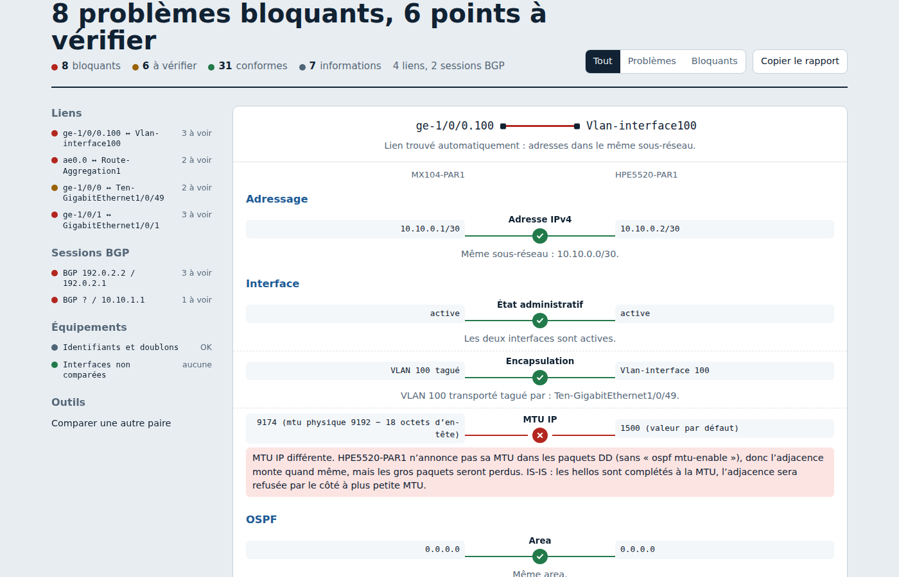

# Vis-à-vis

Comparateur de configurations de routeurs voisins. Collez la configuration de deux équipements reliés entre eux : Vis-à-vis retrouve les liens qui les connectent, puis vérifie paramètre par paramètre que chaque côté attend exactement ce que l’autre envoie.



Tout s’exécute dans le navigateur : aucune configuration n’est envoyée sur un serveur, aucune dépendance n’est à installer.

## Constructeurs pris en charge

| Constructeur | Modèles testés | Commande à exporter |
|---|---|---|
| Juniper Junos | MX104 (et MX, EX, QFX, SRX, ACX) | `show configuration` ou `show configuration \| display set` |
| HPE Comware 7 | 5520 HI (et 5940, 5710, 7500…) | `display current-configuration` |

Pour Junos avec des `apply-groups`, préférez `show configuration | display inheritance | display set`.

## Utilisation en local

Trois possibilités, sans rien installer :

1. **Fichier unique (recommandé hors ligne)** : ouvrez `dist/vis-a-vis.html` dans un navigateur. Ce fichier contient tout ; vous pouvez le copier sur une clé USB ou un poste isolé.
2. **Version découpée** : ouvrez directement `index.html` (double-clic).
3. **Petit serveur local**, si votre navigateur restreint les fichiers locaux :
   ```
   python3 -m http.server 8000
   ```
   puis ouvrez http://localhost:8000.

Sans accès internet, les polices Google ne se chargent pas et l’outil utilise les polices du système. Tout le reste fonctionne.

Raccourci : `Ctrl + Entrée` lance la comparaison. Le bouton « Charger l’exemple » montre l’outil sur une configuration MX104 et une configuration HPE 5520 contenant des erreurs volontaires.

## Héberger sur GitHub

```
git init
git add .
git commit -m "Vis-à-vis 1.0.0"
git branch -M main
git remote add origin https://github.com/<votre-compte>/vis-a-vis.git
git push -u origin main
```

Pour obtenir une page en ligne : **Settings → Pages → Build and deployment → Deploy from a branch**, branche `main`, dossier `/ (root)`. L’outil sera disponible à l’adresse `https://<votre-compte>.github.io/vis-a-vis/`.

L’intégration continue (`.github/workflows/ci.yml`) lance les tests à chaque push et vérifie que `dist/` est à jour.

> Ne committez jamais de configurations de production : elles contiennent adresses, topologie et clés. Le `.gitignore` exclut le dossier `configs-privees/`.

## Ce qui est vérifié

**Pour chaque lien** (trouvé par sous-réseau commun, par descriptions croisées ou désigné à la main) :

- adressage : même sous-réseau, même masque, pas de doublon, pas d’adresse réseau ou de broadcast ;
- état administratif, vitesse et duplex ;
- encapsulation : `vlan-id` Junos face à une `Vlan-interface` HPE, avec recherche du port qui transporte réellement le VLAN ;
- MTU IP effective, recalculée selon les règles de chaque constructeur ;
- agrégats : mode LACP, cadence, nombre de membres, liens minimum ;
- niveau 2 : VLAN non tagué (natif ou accès), VLAN tagués présents d’un seul côté ;
- OSPF et OSPFv3 : area, type d’area, interface passive, type de réseau, timers, authentification, coût, BFD ;
- IS-IS : famille ISO, type de circuit, niveaux communs, area pour le L1, authentification, BFD ;
- MPLS : LDP des deux côtés et prérequis (`family mpls`, `mpls enable`, `mpls ldp`, `lsr-id`), RSVP.

**Pour chaque session BGP** : réciprocité, adresses source, AS attendus dans les deux sens, type iBGP/eBGP, multihop eBGP, mot de passe MD5, familles d’adresses, hold time, BFD.

**Globalement** : router-ID, NET IS-IS, LSR-ID, adresses IP en double, LLDP.

## Développement

Il suffit de Node.js 18 ou plus récent, sans aucune dépendance.

```
node tests/run.js      # tests du moteur
node tools/build.js    # régénère js/ui/samples.js et dist/vis-a-vis.html
```

Après toute modification, relancez la construction et committez `dist/`.

```
index.html                 page et ordre de chargement des scripts
css/style.css
js/core/                   IP, texte, secrets, modèle commun, registre des constructeurs
js/vendors/junos.js        lecture Junos + adaptateur
js/vendors/comware.js      lecture Comware 7 + adaptateur
js/analysis/               vues effectives et contrôles (indépendants des constructeurs)
js/ui/                     interface et exemples
samples/                   configurations d’exemple
tests/                     tests Node
tools/build.js             construction du fichier unique
dist/vis-a-vis.html        version autonome
docs/                      documentation
```

Pour ajouter un fabricant, lisez [docs/ajouter-un-constructeur.md](docs/ajouter-un-constructeur.md).

## Limites connues

- Les clés HPE `$c$` sont chiffrées de façon non réversible : l’outil signale qu’elles sont à comparer à la main. Les clés Junos `$9$` sont décodées localement pour la comparaison et ne sont jamais affichées.
- Les `apply-groups` Junos ne sont pas dépliés (utilisez `display inheritance`).
- Les liens de niveau 2 sans adresse IP ne sont trouvés que par les descriptions ou par une paire manuelle.

## Licence

MIT, voir [LICENSE](LICENSE).
